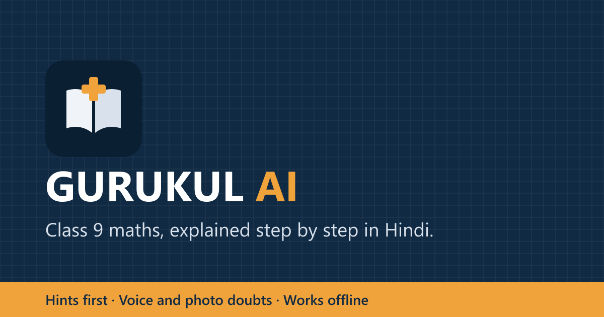
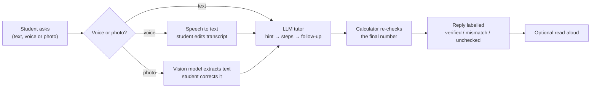

<div align="center">



# GURUKUL AI

**A Hindi-first AI tutor for school students in Classes 1 to 12, built for low-cost Android phones and unreliable internet.**

*Built in the **Codebenders IDE** (the IDE provided for the ACE Builders Global Hackathon 2026), together with AI coding assistants.*

[](https://gurukul-ai.vercel.app)
[](https://gurukul-ai-o0nq.onrender.com/api/health)


[**Live app**](https://gurukul-ai.vercel.app) · [Quick start](#quick-start) · [Architecture](#architecture) · [API](#api-reference) · [Limitations](#known-limitations)

</div>

---

> [!NOTE]
> **Working prototype**, built for the **ACE Builders Global Hackathon 2026**, Problem Statement 3: *The Last-Mile Tutor*. Lessons and questions are original sample content written for this project, not official JAC material. Read [Verification status](#verification-status) and [Known limitations](#known-limitations) before relying on it.

## Try it

| | |
|---|---|
| **Web app** | https://gurukul-ai.vercel.app |
| **API health** | https://gurukul-ai-o0nq.onrender.com/api/health |

> [!TIP]
> The API runs on Render's free tier, so the first request after a quiet period can take up to a minute while the server wakes up.

## Contents

- [The problem](#the-problem)
- [Features](#features)
- [Classes 1 to 12](#classes-1-to-12)
- [How a question is answered](#how-a-question-is-answered)
- [Architecture](#architecture)
- [Quick start](#quick-start)
- [Configuration](#configuration)
- [Database (Turso)](#database-turso)
- [AI, voice and photo](#ai-voice-and-photo)
- [Offline learning and sync](#offline-learning-and-sync)
- [Security and privacy](#security-and-privacy)
- [Design and accessibility](#design-and-accessibility)
- [Performance](#performance)
- [API reference](#api-reference)
- [Testing](#testing)
- [Deployment](#deployment)
- [Troubleshooting](#troubleshooting)
- [Verification status](#verification-status)
- [Known limitations](#known-limitations)
- [Roadmap](#roadmap)
- [Project structure](#project-structure)
- [Contributing](#contributing)
- [Credits and licences](#credits-and-licences)

---

## The problem

Many school students in India, from Class 1 to Class 12, study on a shared, low-cost phone, with patchy mobile data and nobody at home to ask when they get stuck. GURUKUL AI is designed around those conditions:

| Principle | What it means in the app |
|---|---|
| **Hindi first** | Hindi by default, with Hinglish (Hindi in Roman letters) and English one tap away. The tutor can also reply in Telugu |
| **Right level for every class** | The tutor teaches a Class 2 child, a Class 8 student and a Class 12 student differently, and stays inside the student's own class, board and subjects |
| **Hints before answers** | The tutor teaches step by step instead of handing out solutions |
| **Works on a weak network** | Lessons and practice keep working offline and sync later |
| **Honest about AI** | Numeric answers are re-checked by a calculator, and uncertain or unverified answers are labelled |
| **Safe for minors** | Students give only a name and username, and declare that a parent or guardian agreed. Guardians see progress, never tutor conversations |

## Features

| Feature | What the student gets | Offline |
|---|---|:---:|
| **Class and subject choice** | Pick class (1–12), board, session, medium, stream (11–12) and subjects. Only subjects of that class are shown. Changing class keeps earlier progress | ✗ |
| **AI tutor** | A hint first, then a step-by-step solution, then a follow-up question, pitched at the student's class and subject. Hindi, Hinglish, English or Telugu | Questions typed offline are saved and answered on reconnect |
| **Answer checking** | A deterministic calculator re-checks the tutor's final number and shows whether it matched | ✗ |
| **Voice tutor** | Speak the question, check and edit the transcript, then listen to the reply with play, pause, replay and stop. Typing always works as a fallback | ✗ |
| **Photo questions** | Photograph a question from a book or notebook. The image is compressed on the phone; the student can correct the extracted text before asking | ✗ |
| **Lessons** | Class 9 maths: 12 chapters, 24 short lessons with worked examples, in Hindi and English. Other classes: official NCERT chapter titles (maths, several classes) or book details | ✓ after download (lessons only) |
| **Adaptive practice** | 72 Class 9 maths questions at three levels. Difficulty moves up or down with each answer; weak topics come first, with an explanation for every mistake | ✓ after download |
| **Chapter quizzes** | A timed quiz per chapter, graded on the server | ✗ |
| **Progress** | Topic mastery, accuracy, daily streak and recommended next steps | Read only |
| **Parent and teacher view** | A guardian links with a 6-character code the student shares, and sees progress, weak topics and activity, but never the tutor conversations | ✗ |
| **Installable app** | A PWA that installs to the home screen and caches the app shell | ✓ |

## Classes 1 to 12

Students choose their class, board, academic session, medium, stream (Classes 11–12) and subjects during onboarding, and can change them later under **Settings → Class and subjects**. The choice drives what they see everywhere: subjects and chapters, practice, quizzes, recommendations, the tutor's teaching style, and the class shown to parents and teachers.

| Stage | Classes | How the tutor teaches |
|---|---|---|
| Primary | 1–5 | Very short sentences, one idea at a time, things to count or picture, a small activity |
| Middle | 6–8 | Builds the concept from a relatable example, introduces terms gently, guided practice |
| Secondary | 9–10 | Board-exam style: concept, reasoned steps, properly written answer, a common mistake |
| Senior secondary | 11–12 | Deeper concepts with correct terminology, method and reasoning, board-style problem solving |

**What exists today, honestly:**

| Content | Coverage | Source |
|---|---|---|
| Subjects and textbooks, Classes 1–12 | All classes (4 to 25 subjects per class), session 2026-27 | Official NCERT textbook list, [ncert.nic.in/textbook.php](https://ncert.nic.in/textbook.php), read 21 Nov 2026 |
| Subjects and textbooks, earlier sessions | All classes, sessions 2025-26 and 2024-25, with that year's books (e.g. Class 4 maths: *Math-Magic* in 2024-25, *Math-Mela* in 2025-26). Maths chapter titles only where the book is unchanged in 2026-27 (Classes 2, 6, 10, 11, 12) | Archived copies of the same NCERT page on archive.org: [13 Aug 2025](https://web.archive.org/web/20250813112136/https://ncert.nic.in/textbook.php), [15 Aug 2024](https://web.archive.org/web/20240815162514/https://ncert.nic.in/textbook.php) |
| Maths chapter titles | Classes 2, 6, 7, 9, 10, 11, 12 | Contents page of each NCERT maths book (front-matter PDF). Classes 1, 3, 4, 5 and 8 show the official chapter count only: their contents pages could not be read as text |
| Lessons, practice questions and quizzes | Class 9 maths only (original sample content, based on the earlier NCERT book, session 2025-26) | Written for this project |
| Other subjects | Book titles and chapter counts; the AI tutor answers questions | Official NCERT list |

| Board | Status | Why |
|---|---|---|
| JAC | Not verified | Subjects come from NCERT's list. An official JCERT 2021-22 document shows JAC followed NCERT for Class 9, but the current JAC syllabus could not be checked |
| CBSE | Partly verified | Subjects and books are NCERT's official list. CBSE's own scheme of studies was not checked separately |
| ICSE | Not available | No official source checked; it cannot be selected |

Streams for Classes 11–12 (Science, Commerce, Humanities) are suggestions that pre-select common subjects; students can change any subject. NCERT itself does not define streams.

The catalogue is data, not code: [`backend/content/curriculum-catalog.json`](backend/content/curriculum-catalog.json), loaded by `npm run db:seed`.

## How a question is answered



1. The student types, speaks or photographs a question. Voice and photo input are always shown as editable text before anything is sent to the tutor.
2. The tutor (Groq, or Gemini as a fallback) replies in a fixed structure: a hint, numbered steps, a final answer, a follow-up question and its own confidence level.
3. For arithmetic and one-variable linear answers, a deterministic calculator recomputes the result. A mismatch is shown to the student with a warning not to rely on the answer.
4. With no AI key configured, the tutor runs in a clearly labelled **demo mode** that shows only the calculator result and the linked lesson summary.

## Architecture

```
 ┌──────────────────────────────┐        HTTPS / JSON         ┌──────────────────────────────┐
 │  Frontend (PWA)              │  ─────────────────────────▶ │  Backend API                 │
 │  React 18, Vite, TypeScript  │                             │  Node.js, Express, TypeScript│
 │  Tailwind, TanStack Query    │  ◀───────────────────────── │  Zod validation, JWT auth    │
 │                              │                             │  Drizzle ORM                 │
 │  IndexedDB: chapter packs,   │                             └──────┬───────────────┬───────┘
 │  offline answer queue,       │                                    │               │
 │  cached voice replies        │                                    ▼               ▼
 │  Service worker: app shell   │                          ┌──────────────┐  ┌────────────────────┐
 └──────────────────────────────┘                          │ Turso        │  │ AI providers       │
   hosted on Vercel                                        │ (libSQL)     │  │ Groq / Gemini      │
                                                           └──────────────┘  │ Sarvam (voice)     │
                                                                             └────────────────────┘
```

| Layer | Technology |
|---|---|
| Frontend | React 18, Vite, TypeScript, Tailwind CSS, React Router, TanStack Query, React Hook Form, Zod, `idb` |
| Backend | Node.js 20+, Express 4, TypeScript, Zod, JSON Web Tokens, bcrypt, Multer, Helmet, express-rate-limit |
| Database | Turso (libSQL) with Drizzle ORM and SQL migrations |
| AI | Groq (default LLM, vision, Whisper), Google Gemini (optional fallback), Sarvam AI (optional speech) |
| Hosting | Vercel (frontend), Render (backend API), Turso (database) |

## Quick start

**You need:** Node.js 20 or newer, and a [Turso](https://turso.tech) database (free tier is enough). There is no local database; the backend always talks to Turso.

### 1. Create the database

```bash
npm i -g @tursodatabase/cli         # or follow turso.tech/docs
turso auth login
turso db create gurukul-ai --location aws-ap-south-1
turso db show gurukul-ai --url       # -> TURSO_DATABASE_URL
turso db tokens create gurukul-ai    # -> TURSO_AUTH_TOKEN
```

### 2. Start the backend

```bash
cd backend
cp .env.example .env                 # Windows: copy .env.example .env
# Fill in TURSO_DATABASE_URL, TURSO_AUTH_TOKEN, JWT_SECRET, JWT_REFRESH_SECRET
# and (optionally) AI_API_KEY for the live AI tutor.
npm install
npm run db:check                     # read-only: is the database reachable?
npm run db:migrate                   # create tables (first time)
npm run db:seed                      # Classes 1-12 catalogue + Class 9 maths lessons (no accounts)
npm run dev                          # http://localhost:5000/api
```

### 3. Start the frontend

```bash
cd frontend
cp .env.example .env                 # Windows: copy .env.example .env
npm install
npm run dev                          # http://localhost:5173
```

There are no built-in accounts. Open http://localhost:5173/register to create a student, parent or teacher account.

### Scripts

| Command | Backend | Frontend |
|---|---|---|
| `npm run dev` | API with live reload | Vite dev server |
| `npm run build` | Compile to `dist/` | Type-check and build to `dist/` |
| `npm start` | Run the compiled API | — |
| `npm run lint` | Type-check `src`, `scripts` and `tests` | Type-check |
| `npm test` | Vitest on a throwaway database | Vitest |
| `npm run preview` | — | Serve the production build (service worker active) |
| `npm run db:check` | Read-only connection and table check | — |
| `npm run db:migrate` | Apply pending migrations (non-destructive) | — |
| `npm run db:seed` | Upsert the Classes 1–12 catalogue and the Class 9 maths lessons (creates no accounts) | — |
| `npm run db:generate` | Create a migration from `src/db/schema.ts` | — |
| `npm run db:studio` | Browse data in Drizzle Studio | — |

## Configuration

Each app reads its own `.env`, created from `.env.example`. Real `.env` files are git-ignored. The backend validates every variable at startup and refuses to start if a required one is missing or invalid.

<details>
<summary><strong>backend/.env</strong>: core settings</summary>

| Variable | Required | Default | Notes |
|---|---|---|---|
| `TURSO_DATABASE_URL` | yes | — | `libsql://<db>-<org>.turso.io` |
| `TURSO_AUTH_TOKEN` | yes | — | From `turso db tokens create <db>`. Server-side only |
| `JWT_SECRET` | yes | — | At least 32 characters |
| `JWT_REFRESH_SECRET` | yes | — | At least 32 characters; must differ from `JWT_SECRET` |
| `ACCESS_TOKEN_TTL` | no | `15m` | Access token lifetime |
| `REFRESH_TOKEN_TTL_DAYS` | no | `7` | Refresh token lifetime |
| `PORT` | no | `5000` | |
| `FRONTEND_URL` | no | `http://localhost:5173` | Allowed CORS origins, comma-separated |
| `UPLOAD_DIR` | no | `uploads` | Temporary folder; files are deleted after processing |
| `MAX_UPLOAD_MB` | no | `6` | Upload size limit |
| `COOKIE_SECURE` | no | off | `true` in production over HTTPS |
| `COOKIE_SAMESITE` | no | `lax` | `none` when the API and web app are on different sites |
| `ENFORCE_HTTPS` | no | off | Use with `TRUST_PROXY=true` behind a TLS proxy; adds HSTS |
| `TRUST_PROXY` | no | off | |

Generate secrets with `node -e "console.log(require('crypto').randomBytes(48).toString('hex'))"`.

</details>

<details>
<summary><strong>backend/.env</strong>: AI tutor, vision and voice</summary>

| Variable | Default | Notes |
|---|---|---|
| `AI_PROVIDER` | `groq` | `groq` or `openai-compatible` |
| `AI_API_KEY` | empty | Groq key. Empty means no Groq tutor, Whisper or vision |
| `AI_MODEL` | `openai/gpt-oss-120b` | Tutor model |
| `AI_VISION_MODEL` | `qwen/qwen3.8-27b` | Photo question model |
| `AI_STT_MODEL` | `whisper-large-v3` | Groq Whisper model |
| `AI_BASE_URL` | `https://api.groq.com/openai/v1` | Any OpenAI-compatible endpoint |
| `AI_TIMEOUT_MS` | `30000` | |
| `AI_REASONING_EFFORT` | `low` | Thinking time for `gpt-oss` and Gemini 2.5 models: `off`, `low`, `medium`, `high`. `low` gives much faster replies |
| `AI_FALLBACK_MODEL` | `openai/gpt-oss-20b` | Second Groq model, used when the main one is rate-limited or down (each Groq model has its own limit). Then Gemini, if `GEMINI_API_KEY` is set. Empty means no fallback model |
| `LLM_PROVIDER` | `auto` | `auto`: Groq if `AI_API_KEY` is set, else Gemini if `GEMINI_API_KEY` is set, else demo mode |
| `GEMINI_API_KEY` | empty | From https://aistudio.google.com/apikey |
| `GEMINI_BASE_URL` | `https://generativelanguage.googleapis.com/v1beta/openai` | |
| `GEMINI_MODEL` | `gemini-2.5-flash` | |
| `STT_PROVIDER` | `auto` | Sarvam if `SARVAM_API_KEY` is set (Groq Whisper takes over if Sarvam fails), else Groq Whisper, else browser only |
| `TTS_PROVIDER` | `auto` | `auto`: Gemini voice first, Sarvam if Gemini fails, then the device voice. Also `gemini`, `sarvam`, `browser` |
| `GEMINI_TTS_BASE_URL` | `https://generativelanguage.googleapis.com/v1beta` | Native Gemini API, used for read-aloud |
| `GEMINI_TTS_MODEL` | `gemini-2.5-flash-preview-tts` | Gemini speech model. Replies are read with an Indian teacher's accent in Hindi, Indian English and Telugu |
| `GEMINI_TTS_VOICE` | `Kore` | Prebuilt voice: Kore, Aoede, Leda (female); Puck, Charon, Orus (male) |
| `SARVAM_API_KEY` | empty | From https://dashboard.sarvam.ai |
| `SARVAM_BASE_URL` | `https://api.sarvam.ai` | |
| `SARVAM_STT_MODEL` | `saarika:v2.5` | |
| `SARVAM_TTS_MODEL` | `bulbul:v3` | `bulbul:v2` was retired by Sarvam |
| `SARVAM_TTS_SPEAKER` | `priya` | Voices for v3 include priya, neha, ritu, kavya, shreya, rahul, aditya, amit, rohan |
| `VOICE_TIMEOUT_MS` | `30000` | |

Groq retires models over time. List what your key can use with `GET https://api.groq.com/openai/v1/models`.

</details>

<details>
<summary><strong>frontend/.env</strong></summary>

Everything here is bundled into the browser, so it must never contain secrets.

| Variable | Notes |
|---|---|
| `VITE_API_URL` | Backend API base URL, e.g. `http://localhost:5000/api` |
| `VITE_SITE_URL` | Public site URL, used for the sitemap, robots.txt and social preview |
| `VITE_APP_NAME` | Display name |
| `VITE_CONTACT_EMAIL` | Public contact address for the footer; hidden when empty |

</details>

## Database (Turso)

The schema lives in [`backend/src/db/schema.ts`](backend/src/db/schema.ts): 27 tables covering accounts, student, parent and teacher profiles, the curriculum hierarchy (boards → academic sessions → classes → subjects → chapters → topics → lessons, questions, quizzes), each student's class-and-subject selections with history, learning sessions, answers, progress, recommendations, tutor conversations, sync records and anonymous analytics. Foreign keys, unique constraints and indexes are defined in the schema and in the generated SQL.

| Concern | How it is handled |
|---|---|
| Connection | One module, [`backend/src/db/client.ts`](backend/src/db/client.ts), checks the connection at startup and reports it on `GET /api/health` without exposing credentials |
| Migrations | `npm run db:migrate` applies only migrations not yet recorded in `__drizzle_migrations`. Migration `0001` (Classes 1–12) only adds tables and nullable columns, inserts boards, sessions and classes, and gives every existing student an active Class 9 JAC selection with their current maths subject, so no data is lost |
| Destructive changes | A migration containing `DROP TABLE`, `DROP COLUMN`, `DELETE FROM` or a table rebuild is refused unless `ALLOW_DESTRUCTIVE_MIGRATION=true` is set after a backup (`turso db shell <db> .dump > backup.sql`). Nothing in the project resets the database |
| Transactions | Registration, account deletion, tutor messages and recommendation updates each run in a single transaction |
| Retries | Transient network errors are retried with backoff, only for work that is safe to repeat |
| Errors | Unique violations return `409`, invalid references `400`, an unreachable database `503` |
| Account deletion | Removes the student's data explicitly in one transaction, so it does not depend on SQLite foreign-key enforcement |

**To change the schema:** edit `schema.ts`, run `npm run db:generate`, review the new SQL file in `backend/drizzle/`, then run `npm run db:migrate`.

## AI, voice and photo

**Providers are chosen automatically** from the keys in `backend/.env`:

| Task | First choice | Fallback | Last resort |
|---|---|---|---|
| Tutor (LLM) | Groq | Gemini | Demo mode |
| Speech to text | Sarvam | Groq Whisper | Browser speech recognition |
| Read aloud | Sarvam | — | Device voice |
| Photo reading | Groq vision model | — | "Not configured" message |

**Demo mode.** With no AI key, the tutor reply is clearly labelled *"Demo mode — not an AI answer"*. It contains only a calculator result (for arithmetic or a linear equation) and the summary of the linked lesson. Lessons, practice, quizzes, progress, offline use and the guardian view all work without any key.

**Voice tutor** (`/app/voice`):
- Languages: हिंदी, English, తెలుగు.
- Recordings are re-encoded to 16 kHz mono WAV in the browser and deleted from the server right after transcription.
- With Sarvam, recordings stop at 30 seconds.
- The newest 40 spoken replies are cached on the phone and cleared on logout.
- Without a Sarvam key, read-aloud needs a Hindi or Telugu voice installed on the device; the page says when one is missing.

## Offline learning and sync

1. A student downloads a chapter pack (lessons, questions and answer keys) into IndexedDB.
2. Offline, practice is graded on the phone and every answer is queued locally.
3. When the connection returns, the queue is sent to `POST /api/sync` in batches.
4. The server re-grades every answer. The phone's own grading is never trusted, and future timestamps are clamped.
5. Each record is applied **exactly once**. It is first claimed through a unique `(student, clientId)` key, so a record sent twice, even at the same moment, is reported as `DUPLICATE`.
6. If the database is briefly unreachable, the record comes back as `RETRY` and stays queued on the phone instead of being lost.
7. **Tutor doubts.** A question typed in the tutor while offline is queued as well. On reconnect the server asks the tutor and stores the reply, and the chat refreshes on its own. At most 3 doubts are answered per request; the rest come back as `DEFERRED` and the phone sends them straight away in the next request. A question the server had already answered (the connection dropped after the reply) is not asked twice, and a failed attempt leaves no empty conversation behind.

Voice and photo need internet, and the app says so.

## Security and privacy

- **Minimal data from minors.** Students give a name and username only. No email, phone number, Aadhaar or school ID.
- **Passwords** are hashed with bcrypt (cost 12). Login gives the same error and similar timing whether or not the username exists.
- **Sessions.** Short-lived access tokens, plus a refresh token in an httpOnly cookie that rotates on every use. Reuse of an old refresh token revokes all of that user's sessions.
- **Access control.** Role checks on every route. Guardians see only students who shared a code with them, and never the content of tutor conversations.
- **Abuse protection.** Rate limits on the API, login and registration, AI calls and speech. A honeypot field on registration. Zod validation on every request body.
- **Secrets.** Database and AI keys stay on the server. The frontend bundle contains only public settings.
- **Uploads.** Type and size checked, stored temporarily, then deleted.
- **Analytics.** Anonymous page counts, sent only after the visitor opts in through the cookie banner.
- **Shared phones.** Logging out clears personal data cached on the device.

## Design and accessibility

The interface uses a print-style neo-brutalist look: white paper, 2 px black outlines with hard offset shadows on the main components, red for actions and yellow for highlights. Every page shares one set of tokens (`frontend/tailwind.config.js`, `frontend/src/styles/index.css`) and one component kit (`frontend/src/components/ui`).

| Area | What is in place |
|---|---|
| Language | हिंदी by default, plus Hinglish and English (toggle: हिं · Hing · En). Archivo for Latin text, Mukta for Devanagari, Noto Sans Telugu for Telugu |
| Contrast | Text colours meet WCAG AA (4.5:1 or higher). The one lighter grey is used only for icons and separators |
| Touch targets | Buttons, links and form controls are at least 44 px tall |
| Small screens | Checked at 360 px width on every route with no horizontal scrolling |
| Keyboard and screen readers | Skip link, visible focus ring, labelled controls, `aria-live` status for recording and loading, show/hide password button |
| Motion | No decorative animation; transitions are disabled for users who prefer reduced motion |
| Forms | Inline errors in plain Hindi or English, a 3-step registration, success and error toasts |
| Launch basics | Page titles and descriptions, favicon and app icons, social preview image, sitemap and robots.txt, custom 404 page, cookie banner |

## Performance

Measured on the production build of the Hindi landing page, with the network throttled to 400 kbps and 400 ms latency:

| Metric | Result |
|---|---|
| First visit, total download | about 340 KB (15 requests) |
| Largest contentful paint | about 2.9 s |
| Repeat visit | served from the service worker cache |

Fonts are subset and loaded only for the scripts on screen, routes are split into separate chunks, photos are compressed on the phone before upload, and chapter packs are downloaded once for offline use.

Speed measures added on 2026-11-22 (the measurements above were taken before them):

- **Pages open without waiting.** Once the first screen is up, every other page chunk is downloaded in the background while the phone is idle. This is skipped with Data Saver or on 2G.
- **No cold-start wait.** The Render API sleeps when idle; the app pings `/api/health` as soon as it opens, so login and the first tutor question do not wait for it to wake.
- **Faster tutor replies.** Reasoning models run on low effort (`AI_REASONING_EFFORT`); in one local check a short request took 535 ms instead of 828 ms. The tutor's database look-ups run in parallel before the AI call.
- **Rate limits.** Groq's free tier allows 8,000 tokens per minute per model, and one tutor question uses about 1,200. When the limit is hit, the tutor answers with `AI_FALLBACK_MODEL`, then Gemini, instead of failing.

## API reference

All routes are under `/api`. Protected routes need `Authorization: Bearer <access token>`.

| Module | Endpoints |
|---|---|
| health | `GET /health` |
| auth | `POST /auth/register`, `POST /auth/login`, `POST /auth/refresh`, `POST /auth/logout`, `GET /auth/me` |
| users | `GET/PATCH/DELETE /users/me`, `POST /users/me/password` |
| students | `GET/PATCH /students/me`, `GET /students/me/dashboard`, `POST /students/me/link-code`, `GET/PUT /students/me/curriculum`, `GET /students/me/curriculum/history` |
| catalogue (public) | `GET /catalog` (boards, sessions, Classes 1–12, stream suggestions), `GET /catalog/subjects?board=&session=&class=` |
| parents / teachers | `POST /parents/link`, `GET /parents/students`, `GET /parents/students/:id/report`, `DELETE /parents/students/:id` |
| curriculum | `GET /curriculum` (the student's own subjects; or `?board=&session=&class=`), `GET /curriculum/sources`, `GET /chapters`, `GET /chapters/:slug`, `GET /chapters/:slug/offline-pack`, `GET /topics/:slug`, `POST /topics/:slug/complete` |
| tutor | `GET/POST /tutor/conversations`, `GET/DELETE /tutor/conversations/:id`, `POST /tutor/conversations/:id/messages` |
| voice / vision | `GET /voice/capabilities`, `POST /voice/transcribe?language=hi\|en\|te`, `POST /voice/speak`, `POST /vision/extract` |
| practice | `GET /practice/next?topic=`, `POST /practice/answer`, `POST /practice/sessions`, `POST /practice/sessions/:id/end` |
| assessments | `GET /assessments`, `GET /assessments/:slug`, `POST /assessments/:slug/start`, `POST /assessments/sessions/:id/submit` |
| adaptive | `GET /adaptive/recommendations`, `POST /adaptive/recommendations/recompute`, `POST /adaptive/recommendations/:id/dismiss`, `GET /adaptive/weak-topics` |
| progress | `GET /progress/me`, `GET /progress/me/activity` |
| sync | `POST /sync` (exactly-once batch of offline records) |
| analytics | `POST /analytics/pageview` (anonymous, consent-based) |

## Testing

```bash
cd backend && npm run lint && npm test && npm run build
cd frontend && npm run lint && npm test && npm run build
```

Backend tests never touch the Turso database in `.env`. [`tests/globalSetup.ts`](backend/tests/globalSetup.ts) builds a temporary libSQL database in the OS temp folder, applies the real migrations, seeds it and deletes it afterwards.

| Suite | Covers |
|---|---|
| `backend/tests/api.test.ts` | Registration, login, refresh-token rotation and reuse detection, practice, quizzes, offline sync, demo-mode tutor, guardian access control |
| `backend/tests/db.test.ts` | Health check, CRUD, unique constraints, transaction rollback, JSON columns, progress upsert, nested relations, full account deletion, concurrent duplicate sync, retry policy |
| `backend/tests/voice.test.ts` | WAV helpers, Sarvam and Gemini request formats (mocked), provider selection, voice API without keys, Telugu demo reply |
| `backend/tests/logic.test.ts` | Calculator, answer grading, adaptive difficulty, AI answer verification, streaks |
| `backend/tests/classes.test.ts` | Classes 1–12: catalogue and stages, subject rules per class, Class 1/5/8/10/11/12 flows, Science/Commerce/Humanities combinations, class-aware tutor prompts, changing class with history, migration backfill for existing Class 9 students, guardian consent, privacy |
| `backend/tests/audit.test.ts` | Calculator edge cases, tutor reply structure, hint rules, question choice, atomic offline sync, account isolation |
| `backend/tests/aiFallback.test.ts` | Fallback to the second model and to Gemini on rate limits; no retry on bad requests |
| `frontend/src/**/*.test.ts` | Audio encoding, offline grading, offline queue ownership, retry and deferred doubts, Hindi error messages, Hinglish text |

## Deployment

| Part | Host | URL |
|---|---|---|
| Frontend | Vercel | https://gurukul-ai.vercel.app |
| Backend API | Render | https://gurukul-ai-o0nq.onrender.com |
| Database | Turso (aws-ap-south-1) | private |

### Backend on Render

| Setting | Value |
|---|---|
| Root Directory | `backend` |
| Build Command | `npm ci --include=dev && npm run build` |
| Start Command | `npm run db:migrate && npm run db:seed && npm start` |
| Health Check Path | `/api/health` |

`--include=dev` is required: with `NODE_ENV=production`, npm would otherwise skip TypeScript and the build would fail. The start command applies any pending migrations and upserts the curriculum catalogue before the server starts; neither step drops or resets data. Without the seed step, new students would find no subjects to choose: `GET /api/health` reports `database.catalogSubjects` so this is easy to check.

**Environment** (Render → Environment). Set everything from `backend/.env.example` with real values, plus the production settings below. Do not set `PORT`; Render provides it.

```
NODE_ENV=production
NODE_VERSION=22.12.0
TRUST_PROXY=true
ENFORCE_HTTPS=true
COOKIE_SECURE=true
COOKIE_SAMESITE=none          # frontend and API are on different sites
FRONTEND_URL=https://gurukul-ai.vercel.app
```

Use JWT secrets in production that are different from your local ones.

### Frontend on Vercel

1. Import the repository and set **Root Directory** to `frontend`.
2. [`frontend/vercel.json`](frontend/vercel.json) already configures:
   - the build (`npm run build`, output `dist`);
   - the SPA fallback to `index.html`;
   - long caching for hashed assets, and no caching for `sw.js` and `index.html`;
   - security headers.
3. In **Settings → Environment Variables**, add the values below, then redeploy. Vite fixes them into the bundle at build time.

| Variable | Value |
|---|---|
| `VITE_API_URL` | `https://gurukul-ai-o0nq.onrender.com/api` |
| `VITE_SITE_URL` | `https://gurukul-ai.vercel.app` |
| `VITE_APP_NAME` | `GURUKUL AI` |

Serve everything over HTTPS. Browsers allow service workers, the microphone and the camera only on secure origins.

## Troubleshooting

| Symptom | Cause and fix |
|---|---|
| Browser console: *blocked by CORS policy* calling `localhost:5000` from the Vercel site | `VITE_API_URL` is not set on Vercel, so the build still points at localhost. Set it to the Render URL and redeploy |
| Login works but the user is logged out on refresh, in production | Refresh cookie not sent cross-site. Set `COOKIE_SAMESITE=none` and `COOKIE_SECURE=true` on the backend |
| Render build fails with `tsc: not found` | Use the build command `npm ci --include=dev && npm run build` |
| First request takes up to a minute | Render free tier wakes the server on demand. Later requests are fast |
| Backend exits with `TURSO_DATABASE_URL is required` or `TURSO_AUTH_TOKEN is required` | Fill both in `backend/.env` (or the host's environment). Local database files are not supported outside tests |
| `/api/health` shows `"db":"down"` or `"migrated":false` | Check the Turso URL and token with `npm run db:check`, then run `npm run db:migrate` |
| Tutor reply says *Demo mode* | No `AI_API_KEY` or `GEMINI_API_KEY` on the backend |
| Groq error `model_not_found` | The model was retired. List available models with `GET https://api.groq.com/openai/v1/models` and update `AI_MODEL` / `AI_VISION_MODEL` |
| Microphone or camera does not work | They need HTTPS (or `localhost`) and the user's permission |

## Verification status

What has and has not been checked, as observed during development:

| Item | Status |
|---|---|
| Backend: lint, 123/123 tests, production build | Passing locally (2026-11-22) |
| Frontend: lint, 26/26 tests, production build | Passing locally (2026-11-22) |
| Migration 0001 (Classes 1–12) | Applied to a fresh database in every test run, and rehearsed on a copy shaped like production. **Not yet applied to production** |
| Classes 1–12 screens (onboarding, class change, subject tabs, tutor subject) | Type-checked and built; **not yet checked in a browser or on a phone** |
| Turso database: migration, seed, health check, login and curriculum API | Verified against a live Turso database (2026-11-21) |
| Render deployment | `/api/health` returns `db: up` with migrations applied and AI live; CORS allows the Vercel origin (2026-11-21) |
| Vercel frontend talking to the Render API | Depends on `VITE_API_URL` being set on Vercel; not yet confirmed end to end |
| Groq tutor | Live Hindi and Telugu replies observed during development (2026-11-21) |
| Browser journeys (register, practice, quiz, offline and reconnect, every route on mobile and desktop) | Checked with a headless-browser script during development; the script is not in the repository |
| Sarvam and Gemini | Request formats follow their public docs and are covered by mocked tests only. **Not tested against the live APIs** |
| Telugu strings written by the server | Need review by a native speaker |
| Real low-end Android devices | **Not tested yet** |

## Known limitations

- **Content depth.** Only Class 9 maths has lessons, practice and quizzes. All other classes and subjects have the official subject and book list (and, for maths in several classes, chapter titles) plus the AI tutor. No lessons were generated for them, to avoid inventing syllabus content.
- **Class 9 book change.** NCERT published a new Class 9 maths book (*Ganita Manjari*, April 2026). The existing Class 9 lessons follow the earlier 12-chapter book, so they are filed under session 2025-26.
- **Curriculum alignment.** JAC's current syllabus and CBSE's own scheme of studies were not checked against official documents; ICSE is not available. Chapter titles are shown in English (the Hindi titles were not read from the Hindi books).
- **Guardian consent.** Students declare that a parent or guardian agreed, and a linked parent can confirm it. This is not a verified-consent process.
- **Telugu.** Lessons and questions are in Hindi and English only. Telugu is supported in tutor replies, not in lesson content.
- **Hinglish.** The app text comes from a fixed dictionary ([`frontend/src/lib/hinglish.ts`](frontend/src/lib/hinglish.ts)); any text missing from it shows in English. Lessons, questions and the privacy and terms pages show in English, because the content exists only in Hindi and English. Tutor replies are written by the AI in Hinglish.
- **AI rate limits.** On Groq's free tier, many students asking at once can still exhaust both models. Set `GEMINI_API_KEY` or use a paid Groq tier for a pilot. Replies arrive in one piece (no streaming yet).
- **Password reset.** Students give no email address, so there is no self-service reset.
- **Answer checking.** The calculator confirms only the final number of arithmetic or one-variable linear answers. It does not check reasoning or geometry proofs.
- **Device voices.** Without a Sarvam key, read-aloud depends on the device's installed voices. Browser speech recognition needs internet and works best in Chrome on Android.
- **Background sync.** Sync runs while the app is open. iOS Safari has no Background Sync API, so syncing happens on reconnect or app open.
- **Legal review.** The privacy policy and terms need legal review (for example against India's DPDP Act 2023) before public use.
- **Licence.** Not chosen yet; it will follow a review of the organisers' ownership terms.

## Roadmap

Planned next steps, taken from the gaps above:

- [ ] Verify the current JAC, CBSE and ICSE syllabi against official documents
- [ ] Lessons and question banks beyond Class 9 maths, written from the verified syllabus
- [ ] Hindi chapter titles from the Hindi-medium NCERT books
- [ ] Telugu lessons and practice questions, and native-speaker review of server-written Telugu strings
- [ ] Field testing on real low-end Android devices and slow networks
- [ ] End-to-end check of the Vercel frontend against the Render API
- [ ] Live testing of Sarvam speech and the Gemini fallback
- [ ] A guardian- or teacher-assisted password reset that does not require a student email
- [ ] Commit the browser journey tests to the repository
- [ ] Stream tutor replies so the first words appear sooner
- [ ] Native-speaker review of the Hinglish text
- [ ] Legal review of the privacy policy and terms (DPDP Act 2023) and a project licence

## Project structure

```
frontend/                 React PWA (deployed on Vercel)
  src/pages/              Routes: public site, auth, student app, guardian app
  src/features/           Tutor, voice, practice and learning components
  src/components/         Shared UI (buttons, fields, layout)
  src/lib/                IndexedDB, offline sync, constants
  public/                 Service worker, manifest, icons
  vercel.json             Build, routing, caching and security headers

backend/                  Express API
  src/db/                 Drizzle schema and the Turso connection
  src/routes/ controllers/ services/ repositories/
  src/middleware/         Auth, security, uploads, errors
  drizzle/                SQL migrations
  scripts/                migrate, seed, db-check
  content/                Curriculum source (class9-maths.json)
  tests/                  Vitest + Supertest
```

There is no root `package.json`. Install and run each app from its own folder.

## Contributing

Issues and pull requests are welcome.

1. Fork the repository and create a branch from `main`.
2. Follow the [Quick start](#quick-start) to run both apps locally against your own Turso database.
3. For schema changes, edit `backend/src/db/schema.ts` and generate a migration with `npm run db:generate`. Never edit an applied migration.
4. Before opening a pull request, run lint, tests and build in both apps (see [Testing](#testing)).
5. Keep student data minimal, keep secrets out of the frontend, and write any new user-facing text in both Hindi and English, and add its Hinglish to `frontend/src/lib/hinglish.ts`.

## Credits and licences

GURUKUL AI is built on open-source software. Main dependencies and their licences:

| Package | Licence |
|---|---|
| React, React Router, TanStack Query, React Hook Form, Zod, Tailwind CSS | MIT |
| Express, Helmet, Multer, express-rate-limit, jsonwebtoken, @libsql/client | MIT |
| Drizzle ORM | Apache-2.0 |
| bcryptjs | BSD-3-Clause |
| lucide-react (icons), idb | ISC |
| Archivo, Mukta, Noto Sans Telugu (fonts, via Fontsource) | SIL Open Font License 1.1 |

All lessons, questions and explanations in `backend/content/` were written for this project. GURUKUL AI is not affiliated with JAC, NCERT or the Government of Jharkhand. The project's own licence has not been chosen yet (see [Known limitations](#known-limitations)).

---

<div align="center">

Made for students in Jharkhand · <a href="https://gurukul-ai.vercel.app">gurukul-ai.vercel.app</a>

</div>
